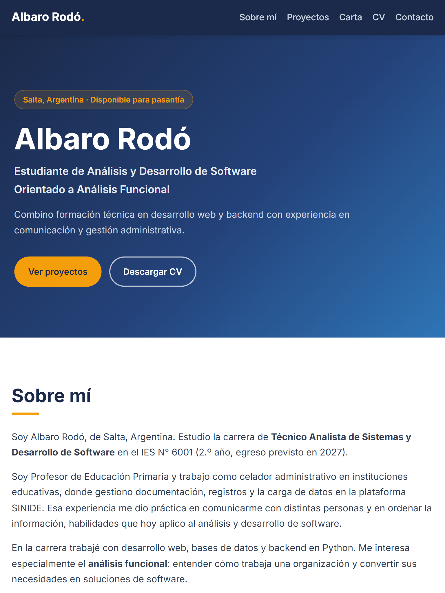
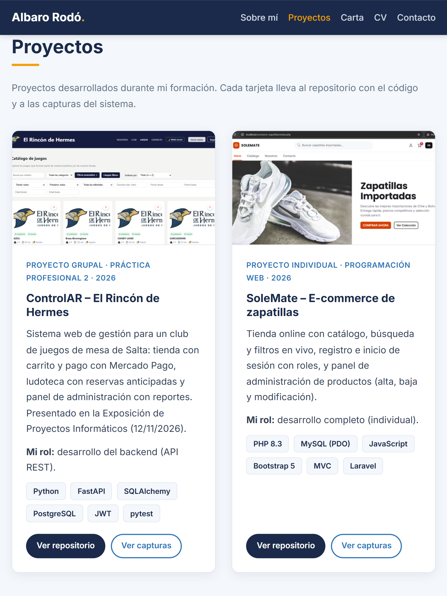
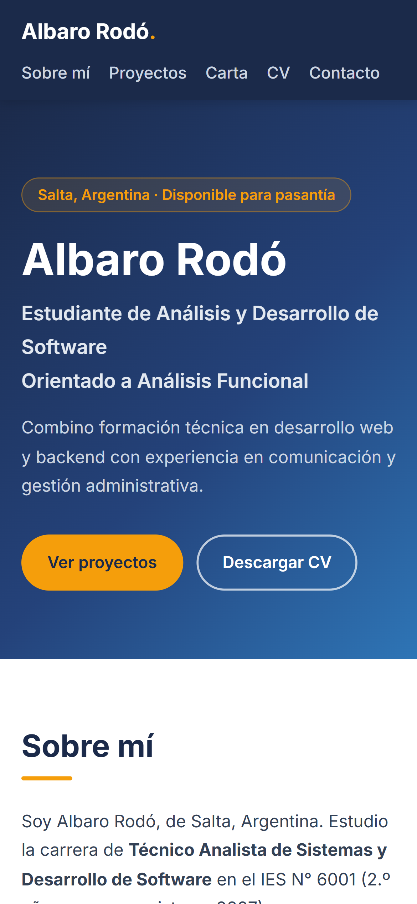
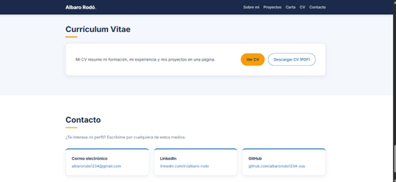

# Portfolio profesional – Albaro Rodó

**Estudiante de Técnico Analista de Sistemas y Desarrollo de Software | Orientado a Análisis Funcional | Salta, Argentina**

🔗 **Sitio publicado:** https://albarorodo1234-oss.github.io/portfolio/

Portfolio personal online desarrollado como parte del trabajo práctico **"Desarrollo de Perfil Profesional IT"** de la materia **Práctica Profesional 2** (IES N° 6001). Junto con el CV y el perfil de LinkedIn, forma mi presentación profesional para buscar oportunidades en el sector IT.

---

## 📋 Contenido del sitio

| Sección | Qué muestra |
|---|---|
| **Inicio** | Nombre, rol buscado y accesos rápidos a los proyectos y al CV. |
| **Sobre mí** | Descripción personal y profesional, datos principales, conocimientos técnicos y habilidades. |
| **Proyectos** | Tarjetas de presentación de cada proyecto, con imagen, descripción, mi rol, tecnologías, enlace al repositorio y capturas. |
| **Carta de presentación** | Mi perfil profesional, mis intereses y mis objetivos laborales. |
| **Currículum Vitae** | Botones para ver el CV en el navegador o descargarlo en PDF. |
| **Contacto** | Correo electrónico, LinkedIn y GitHub. |

### Proyectos incluidos
- **ControlAR – El Rincón de Hermes** (grupal, Práctica Profesional 2): sistema web de gestión para un club de juegos de mesa, con tienda, ludoteca y panel de administración. Mi rol: desarrollo del backend con Python y FastAPI. Presentado en la Exposición de Proyectos Informáticos (12/11/2026). [Repositorio](https://github.com/Florare83/ControlAR)
- **SoleMate – E-commerce de zapatillas** (individual, Programación Web): tienda online en PHP 8.3 y MySQL con patrón MVC y un módulo en Laravel. [Repositorio](https://github.com/albarorodo1234-oss/ecommerce-zapatillas)

---

## 🛠️ Tecnologías utilizadas

- **HTML5 semántico:** `header`, `nav`, `main`, `section`, `article`, `aside`, `figure` y `footer`.
- **CSS3 con variables** (`:root`) para colores, sombras y medidas reutilizables.
- **Flexbox:** encabezado, botones, tarjetas y pie de página.
- **CSS Grid:** sección "Sobre mí" y galerías auto-responsive (`repeat(auto-fit, minmax(...))`).
- **Diseño responsive mobile-first**, con puntos de quiebre en 768 px (tablet) y 1024 px (computadora).
- **Accesibilidad:** textos alternativos en las imágenes, enlace "Saltar al contenido", contorno visible con teclado y respeto por la preferencia de menos movimiento.
- **Google Fonts** (Inter).
- **Git y GitHub** para el control de versiones y **GitHub Pages** para la publicación.

> El sitio es **estático** (solo HTML y CSS, sin servidor). Por eso no tiene formulario de contacto: los botones de contacto abren el correo, LinkedIn o GitHub directamente.

---

## 🤖 Uso de la inteligencia artificial

El diseño y la estructura inicial del sitio se desarrollaron con la asistencia de **Claude (Anthropic)** como herramienta de IA. Todos los contenidos se basan en mi información personal y profesional.

---

## 📁 Estructura del repositorio

```
portfolio/
├── index.html            # Página principal del portfolio
├── style.css             # Estilos (variables, Flexbox, Grid y responsive)
├── README.md
├── assets/
│   ├── cv/
│   │   └── CV-Albaro-Rodo.pdf   # CV que se ve o descarga desde el sitio
│   └── img/              # Capturas de los proyectos (ControlAR y SoleMate)
└── docs/
    ├── capturas/         # Capturas del portfolio para este README
    └── tp1/              # Archivos del TP anterior (reflexión, notas y capturas)
```

---

## 💻 Cómo ver el sitio en local

1. Clonar el repositorio:
   ```
   git clone https://github.com/albarorodo1234-oss/portfolio.git
   ```
2. Abrir la carpeta en **VS Code**.
3. Con la extensión **Live Server**: clic derecho sobre `index.html` → **Open with Live Server**. También se puede abrir `index.html` con doble clic en el navegador.

---

## 🔀 Flujo de trabajo con Git

- Trabajo en la rama `feature/portfolio-profesional`, creada desde `main` (sin trabajar directamente en `main`).
- Commits atómicos con prefijos: `feat:`, `style:`, `refactor:`, `chore:` y `docs:`.
- Pull Request hacia `main`, fusionado con **"Create a merge commit"**.
- Publicación automática con GitHub Pages desde la rama `main`.

---

## 📸 Capturas

### Inicio (computadora)


### Proyectos (computadora)


### Vista en celular (iPhone 12 Pro, 390 px)


### CV y contacto (computadora)


---

## 👤 Autor

**Albaro Rodó** – Técnico Analista de Sistemas y Desarrollo de Software (en curso), IES N° 6001.
[LinkedIn](https://www.linkedin.com/in/albaro-rodo) · [GitHub](https://github.com/albarorodo1234-oss) · albarorodo1234@gmail.com
